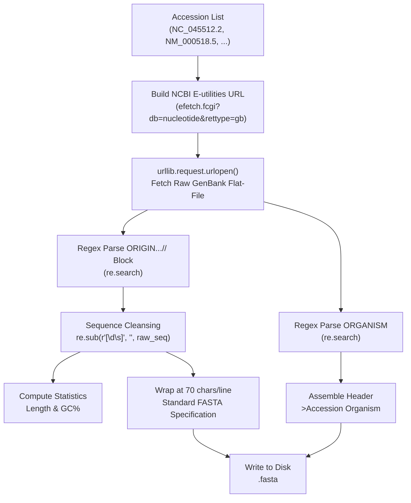

# FASTA Generation Methodology & Planned Accessions Rationale

**Course:** Bioinformatics Course — MS Data Science — Fall 2026  
**Institution:** Punjab University College of Information Technology (PUCIT)  
**Student Name:** Muhammad Imran Mian  
**Roll Number:** MSDSF25A007  
**Instructor:** Dr. Shahid Manzoor  
**Program:** MS Data Science  

---

## 1. Planned vs. Random Accessions

The 5 nucleotide accessions utilized in this assignment were **strictly planned and curated**, rather than chosen at random. 

In bioinformatics workflows, querying random accessions poses severe reliability issues:
- Many NCBI nucleotide entries are **WGS/CON records** (segmented master records or contig pointers) that do **not contain an inline sequence (`ORIGIN` block)**.
- Many entries are entire mammalian chromosomes spanning hundreds of millions of base pairs, which would cause network timeouts, excessive memory consumption, and massive disk writes.
- Random records fail to provide a meaningful biological distribution for benchmarking sequence statistics like GC content.

### Rationale Behind the 5 Chosen Accessions

| Accession | Biological Entity & Scientific Name | Biological Type | Length (bp) | GC% | Methodological Rationale |
| :--- | :--- | :--- | :---: | :---: | :--- |
| **NC_045512.2** | Severe acute respiratory syndrome coronavirus 2 (*SARS-CoV-2*) | Positive-sense ssRNA viral genome | 29,903 bp | 37.97% | Global reference genome; demonstrates mid-length viral genome processing with low-to-moderate GC content. |
| **NM_000518.5** | *Homo sapiens* hemoglobin subunit beta (*HBB*) mRNA | Eukaryotic mRNA / coding transcript | 628 bp | 51.27% | Classic human clinical genetic model; validates handling of shorter, highly annotated transcript records with balanced GC. |
| **NR_046235.3** | *Homo sapiens* RNA, 45S pre-ribosomal N4 (*RNA45SN4*) | Non-coding ribosomal RNA precursor | 13,357 bp | 72.55% | Critical benchmark for high-GC structural RNA parsing and GC-content skew detection. |
| **NC_001416.1** | Escherichia phage Lambda (*Enterobacteria phage lambda*) | Double-stranded DNA bacteriophage genome | 48,502 bp | 49.86% | Canonical molecular biology model organism; demonstrates processing of larger prokaryotic viral genomes (~48.5 kb). |
| **AY278741.1** | SARS coronavirus Urbani (*SARS-CoV*) | Complete viral genome (2003 strain) | 29,727 bp | 40.80% | Historical comparative reference to SARS-CoV-2; verifies repeatability on coronavirus genomic architectures. |

---

## 2. End-to-End Generation Methodology

The generated `.fasta` files were **not** downloaded directly as ready-made FASTA files from a web browser. Instead, our custom script `retrieve_sequences_plain.py` executed a complete bioinformatics extraction and conversion pipeline using **only Python standard library modules** (`urllib`, `re`, `ssl`, `time`, `os`).



### Detailed Pipeline Breakdown

### Step A: Manual HTTP Request Construction
For each accession, an E-utilities request is constructed targeting the NCBI Entrez REST interface:
```text
https://eutils.ncbi.nlm.nih.gov/entrez/eutils/efetch.fcgi?db=nucleotide&id=<ACCESSION>&rettype=gb&retmode=text
```
The script dispatches an HTTP GET request using `urllib.request.Request` with an academic User-Agent header and manages SSL verification gracefully.

### Step B: Metadata Parsing via Regular Expressions
The GenBank flat-file format stores taxonomic metadata in structured multi-line headers. The organism scientific name is extracted using:
```python
match = re.search(r"^\s*ORGANISM\s+(.+)$", genbank_text, re.MULTILINE)
organism = match.group(1).strip()
```

### Step C: Sequence Extraction and Sanitization
GenBank records store the nucleotide sequence at the end of the file between the `ORIGIN` header and the record-terminating `//` delimiter. The raw text interleaves base pairs with 60-character line lengths, 9-digit base counters, and whitespaces:
```text
ORIGIN      
        1 acatttgctt ctgacacaac tgtgttcact agcaacctca aacagacacc atggtgcatc
       61 tgactcctga ggagaagtct gccgttactg ccctgtgggg caaggtgaac gtggatgaag
//
```
1. **Block extraction:**
   ```python
   match = re.search(r"\bORIGIN\s*\n([\s\S]*?)(?:\n\s*//|\Z)", genbank_text)
   raw_block = match.group(1)
   ```
2. **Noise stripping:**
   Line numbers (`\d`) and whitespace/newlines (`\s`) are stripped using regex, and the resulting string is converted to uppercase:
   ```python
   clean_seq = re.sub(r"[\d\s]", "", raw_block).upper()
   ```

### Step D: Standard-Compliant FASTA Formatting
Standard FASTA format requires:
1. A single description line beginning with `>` followed by the identifier and organism.
2. The sequence lines wrapped at a uniform width (the assignment specification mandates **70 characters per line**).

The script wraps the sanitized sequence string into 70-character chunks:
```python
wrapped_seq = "\n".join(sequence[i:i + 70] for i in range(0, len(sequence), 70))
```
The formatted content is then written to `<accession>.fasta`.

### Step E: Direct String Mathematics (Length and GC Content)
Without relying on external bioinformatics libraries, the sequence length and Guanine-Cytosine (GC) ratio are calculated directly from the clean sequence string:
$$\text{GC\%} = \frac{\text{Count}(\text{'G'}) + \text{Count}(\text{'C'})}{\text{Total Sequence Length}} \times 100$$

### Step F: Rate-Limiting & Fault Tolerance
To comply with NCBI's fair-use API guidelines (< 3 unauthenticated requests per second), the script executes a mandatory pause between queries (`time.sleep(0.4)`). Network operations are wrapped in `try/except` blocks to ensure a transient error on one accession does not terminate batch processing.
